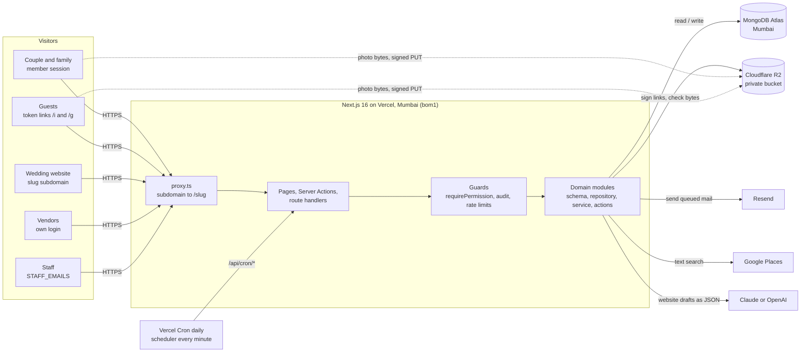

# Make My Marriage — System Design & Architecture (v1)

Oct 5, 2026 · @Parth Khunteta · updated Oct 14, 2026 to match the code as built

## 1. Overview and principles

Make My Marriage v1 runs as a single Next.js application on Vercel, backed by a MongoDB Atlas cluster and Cloudflare R2 for photos.

### Confirmed decisions

|Decision|Choice|
|---|---|
|Architecture|Modular monolith, one codebase, one deploy|
|Framework|Next.js 16 (App Router), React Server Components|
|Runtime|Node.js, TypeScript end to end|
|Database|MongoDB Atlas, managed cluster|
|Hosting|Vercel|
|Media storage|Cloudflare R2, zero egress fees|
|Auth|In-house: email and password, Argon2id, signed cookie sessions (section 7)|

### What the architecture must carry

- **Five surfaces in one app:** the member dashboard, guest pages with no login, the public wedding website, the vendor portal, and a small staff area for the Make My Marriage team.

- **Wedding-scoped data:** every record belongs to exactly one wedding, and no query may cross that boundary.

- **Guest traffic in bursts:** one invitation send reaches 300 to 500 parties at once, and photo uploads spike during an event.

- **Seasonal peaks:** Indian weddings cluster into a few weeks each winter, so load is uneven across the year.

- **Photo weight:** a wedding can hold 5,000 or more photos, with guests uploading from the venue on patchy mobile data.

### Principles

1. **Boundaries in code, not in infrastructure.** Modules are separated by folder and interface so a module can later move out, but v1 ships as one deployable.

2. **Server-first.** Data fetching and mutations run on the server through Server Components and Server Actions; the browser gets as little logic as possible.

3. **Every query is scoped.** A shared data-access layer injects `weddingId` into every read and write, so isolation is not left to each caller.

4. **Heavy bytes bypass the app.** Photos go browser → R2 directly with presigned URLs, never through a serverless function.

5. **Buy the plumbing.** Email, storage, places and AI writing come from managed services, so the team builds wedding features. QR codes are generated in-process.

### What changed since the v1 plan

The plan below was written before the build. These are the places where the code went a different way; each section has been updated to match.

- **Thumbnails are made in the browser,** not by a Cloudflare Worker. The browser uploads the original plus a 1600 px and a 400 px copy; there is no Worker and no R2 webhook.
- **Photos are served through signed links** that the app issues after checking access, not through a Worker in front of the bucket.
- **Roles became real permissions.** Built-in Admin, Manager, Finance and Viewer roles, custom roles per wedding, and an audit log replace the two-role table. One account can belong to up to five weddings.
- **The email queue is drained by a cron call every minute** from an outside scheduler, plus a daily Vercel Cron. QStash is not used.
- **No bounce webhook yet.** Resend bounces are not fed back into guest records.
- **The wedding website uses a design kit** (palettes, fonts, hero layouts, motifs) and can be designed and written with AI (Claude or OpenAI).
- **Google Places results are not cached;** searches are capped at 30 per wedding per day instead.
- **No cross-module event bus.** Modules call the notifications service directly.
- **CI and end-to-end tests are not set up yet.** Unit and integration tests run locally with Vitest.

## 2. High-level architecture

One Next.js app serves all five surfaces. Photo bytes are the exception: they go from the browser straight to R2.



Every browser request reaches the same app, which keeps all data in Atlas and hands out signed links for R2. The dotted line is the exception that shapes the design: photo bytes go straight from the phone to R2 and never pass through a serverless function, because a Vercel function accepts at most 4.5 MB per request and one photo can be 25 MB.

## 3. Technology stack

Every choice below is either your stated preference or the lightest option that fits a onedeploy monolith on Vercel.

|Layer|Choice|Why|
|---|---|---|
|Framework|Next.js 16, App Router|Your preference; one app serves<br>every surface|
|Language|TypeScript (strict)|Shared types between server and<br>client|
|UI|React Server Components,<br>Tailwind CSS 4, Radix UI|Server-first data, consistent<br>components without a design<br>system build|
|Forms and<br>validation|React Hook Form + Zod|Zod schemas validate on the<br>client and again on the server|
|Database|MongoDB Atlas M10 (Mumbai)|Your preference; M10 gives<br>backups and private networking,<br>M0/M2 do not|
|Driver|Official MongoDB Node driver,<br>thin repository layer|Mongoose adds weight; the driver<br>plus typed repositories keeps<br>queries explicit|
|Media storage|Cloudflare R2|Zero egress; guests downloading<br>photos cost nothing in bandwidth|
|Image processing|In the browser, on a canvas|The 1600 px and 400 px copies are made<br>before upload, so no server or Worker<br>touches the image|
|Email|Resend|Simple API, good deliverability,<br>domain-level DKIM setup|
|Background jobs|Vercel Cron + MongoDB email<br>queue|A daily cron runs reminders, alerts and<br>cleanup; an outside scheduler calls the<br>queue drain every minute|
|Caching and rate<br>limits|MongoDB TTL counters|No extra service; a short-lived<br>counter collection caps RSVP and<br>upload rates|
|Vendor discovery|Google Places API (Text Search)|Already decided in the PRD|
|AI writing|Claude or OpenAI, chosen by<br>`AI_PROVIDER`|Designs and writes the wedding<br>website as checked JSON|
|Live stream|YouTube iframe embed|No streaming infrastructure|
|QR codes|`qrcode`npm package, generated<br>server-side|PNG and SVG for print; no third-<br>party service|
|Exports|CSV for guests, money, vendors<br>and seating; PNG and SVG for QR|No PDF library in v1|
|Error tracking|Application logs|Structured server logs via Vercel;<br>no external tool in v1|
|Product metrics|Database queries|Computed from existing data; no<br>external tool in v1|
|CI/CD|GitHub + Vercel Git integration|Preview deploy per pull request|

### Deliberately not used in v1

- **No separate API server.** Route handlers and Server Actions are the API; a mobile app later would get a versioned REST layer.

- **No Redis.** Rate-limit counters live in MongoDB with a TTL index; sessions live in signed cookies.

- **No message broker.** A MongoDB-backed email queue drained by cron covers the batching v1 needs.

- **No Kubernetes or containers.** Vercel builds and runs the app.

## 4. Application structure

The monolith is organised as modules that mirror the PRD, each owning its collections, business rules and UI.

### Folder layout

```
src/
  app/
    (member)/              member dashboard, requires login
      dashboard/ events/ tasks/ guests/ money/ vendors/
      website/ photos/ live/ analytics/ settings/
    (guest)/               no login, token in the URL
      i/[token]/           personal invitation and RSVP
      g/[token]/           gallery and photo upload
    (public)/
      [slug]/              wedding website (served on slug.makemymarriage.com)
      login/ signup/ ...   account pages, privacy, terms, support
    (vendor)/              vendor portal, separate login
      listing/ bookings/ reviews/
    (staff)/staff/         listing approval and review removal for the team
    api/                   auth, guest token routes, exports, cron entry points
  modules/                 one folder per domain module
    wedding/ members/ events/ tasks/ guests/ invitations/
    seating/ checkin/ money/ vendors/ marketplace/ discover/
    photos/ website/ notifications/ analytics/ search/
    staff/ deletion/
      <module>/
        schema.ts          Zod schemas and TypeScript types
        repository.ts      all MongoDB access for this module
        service.ts         business rules, the only caller of repository
        actions.ts         Server Actions, auth-checked entry points
        components/        UI owned by this module
  lib/
    db.ts                  Atlas client, connection reuse
    scoped.ts              wraps a collection so every query carries weddingId
    context.ts             current user, wedding and permissions per request
    authz.ts  permissions.ts  page-guard.ts   permission checks
    session.ts  revoked-sessions.ts  active-wedding.ts
    storage.ts             R2 presigning (a local folder in development)
    ai/                    Claude and OpenAI behind one generateStructured()
    email.ts  queue.ts  ratelimit.ts  audit.ts
  themes/
    kit.ts                 website palettes, font pairs, hero layouts, motifs
    fonts.ts               the website fonts
```

### Module rules

1. **One way in.** A module is used through its `service.ts` ; nothing outside it touches another module's repository or collections.

2. **Repositories are scoped.** A repository wraps its collection with `scoped()` (`src/lib/scoped.ts`), which adds `weddingId` to every read, write and delete. A lint rule stops anything outside a repository or `src/lib` from opening the database directly.

3. **Server Actions are the boundary.** Each action checks permission with `requirePermission()` (which also resolves the context), validates input with Zod, then calls the service. A test fails the build if any action, route or member page has no guard; the list is kept in `docs/endpoint-permissions.md`.

4. **Cross-module work goes through services.** When an RSVP changes, the invitations service calls the notifications service; no module writes another module's data. (The internal event bus in the original plan was not needed.)

5. **Website looks are data.** A site's look is four choices from the design kit (palette, fonts, hero, motif). The three themes are presets of it and the AI picks its own combination, so a new look is a new entry in `kit.ts`, not new templates.

### Why this holds up

If a module ever needs to scale alone — photos being the likely first — its service is already the seam. It can move behind an HTTP call without touching callers.

## 5. Rendering and routing

Each surface gets the rendering mode its traffic pattern deserves, from always-fresh dashboards to cached public pages.

|Surface|Route|Rendering|Caching|
|---|---|---|---|
|Member<br>dashboard|`/(member)/*`|Dynamic, server-<br>rendered per<br>request|None; always fresh|
|Guest<br>invitation|`/i/[token]`|Dynamic, server-<br>rendered|None; RSVP state<br>must be current|
|Wedding<br>website|`slug.makemymarriage.com`|ISR|Refreshed when settings<br>change, 60s fallback|
|Gallery|`/g/[token]`|Dynamic|Images through signed R2<br>links that expire after an hour|
|Vendor portal|`/(vendor)/*`|Dynamic, server-<br>rendered|None|
|Marketplace<br>browse|`/vendors`|Dynamic|None; filters and<br>sorting per request|
|Staff area|`/staff`|Dynamic|None|

### How a page gets its data

A member page is a Server Component that calls its module service directly — no fetch, no API round trip. Mutations are Server Actions, which validate, authorise, write, then call `revalidatePath` so the affected pages refresh.

### Guest pages

The token in the URL is the entire credential. The page resolves it to an invitation, loads only that guest's events, and renders in the wedding's theme. Nothing on the page reveals other guests or wedding internals.

### Wedding website and ISR

Each wedding site lives at its own subdomain, slug.makemymarriage.com, served by a wildcard DNS record and a wildcard TLS certificate. `src/proxy.ts` (Next.js 16's name for middleware) reads the host header and rewrites the subdomain's root to `/[slug]`. The page is cached for 60 seconds, and saving website settings or AI content calls `revalidatePath` for that slug, so changes show within seconds without rebuilding anything else. This matters during peak season, when hundreds of sites are live at once and most receive heavy read traffic for a few days.

### Mobile

All surfaces are responsive. Guest pages are built to a tighter budget — minimal JavaScript, compressed images, under 3 seconds on 4G — since they are opened from WhatsApp on mid-range Android phones.

## 6. Data layer: MongoDB Atlas

The PRD's relational model maps onto MongoDB by embedding what is read with its parent and referencing what is queried on its own.

### Embed or reference

|Relationship|Decision|Reason|
|---|---|---|
|Wedding settings (theme,<br>slug, toggles, tokens)|Embedded in<br>`weddings`|Read together on every page|
|Events in a wedding|Separate<br>`events`<br>collection|Queried, filtered and linked<br>from everywhere|
|Guests and invitations|Invitations embedded in<br>the guest document|A guest has 3 to 8 invitations;<br>always read with the guest|
|Expense splits|Embedded in the expense|Never queried alone|
|Vendor installments|Embedded in the vendor|Small, bounded, read with the<br>vendor|
|Seating assignments|Embedded in the table<br>document|A table holds 10 to 12 parties|
|Photos|Separate<br>`photos`<br>collection|Thousands per wedding;<br>paginated and filtered|

**Invitations embedded in the guest** is the key decision. The alternative — a separate collection — would need a join on every RSVP screen. Embedded, a guest loads in one read, and per-event headcounts come from an aggregation over the array.

### Collections

|Collection|Holds|Scoped by|
|---|---|---|
|`users`|Member accounts, password<br>hash, email verified|—|
|`weddingRoles`|Custom roles and their<br>permissions|`weddingId`|
|`weddings`|Wedding details, website<br>settings and AI content, gallery<br>settings, budget|—|
|`weddingMembers`|User↔wedding link, roles, muted<br>notifications|`weddingId`|
|`memberInvites`|Pending email invites, token,<br>expiry|`weddingId`|
|`events`|Event details, visibility flags|`weddingId`|
|`tasks`|Title, status, priority, assignee,<br>event link|`weddingId`|
|`guests`|Guest, allowed count, token,<br>`invitations[]`with RSVP and<br>entry token|`weddingId`|
|`expenses`|Amount, category, payer,<br>`splits[]`, links|`weddingId`|
|`budgets`|Per-category and per-event<br>budget amounts|`weddingId`|
|`vendors`|Vendor details,<br>`installments[]`,<br>linked events|`weddingId`|
|`seatingTables`|Table name, capacity,<br>`assignments[]`|`weddingId`,<br>`eventId`|
|`checkIns`|Arrival records per invitation per<br>event|`weddingId`|
|`albums`|Album name, event link|`weddingId`|
|`photos`|R2 keys, uploader, status,<br>dimensions|`weddingId`,<br>`albumId`|
|`notifications`|Type, message, link, read state|`weddingId`|
|`emailQueue`|Each email to send, status,<br>attempts, next try|`weddingId`|
|`rateLimits`|Fixed-window counters, deleted<br>by a TTL index|—|
|`auditLogs`|Who changed access or did<br>something irreversible; kept<br>two years|`weddingId`<br>(or none for<br>staff)|
|`revokedSessions`|Signed-out sessions until they<br>expire|—|
|`vendorAccounts`, `listings`,<br>`bookingRequests`, `reviews`|Marketplace, outside any wedding|—|

### Indexes

```
// Guest lookups and token resolution
guests.createIndex({ weddingId: 1, name: 1 })
guests.createIndex({ token: 1 }, { unique: true })
guests.createIndex({ weddingId: 1, "invitations.eventId": 1,
"invitations.rsvpStatus": 1 })
guests.createIndex({ "invitations.entryToken": 1 })   // gate check-in scan
// Public website and gallery
weddings.createIndex({ slug: 1 }, { unique: true })
weddings.createIndex({ galleryToken: 1 }, { unique: true })
```

```
// Hot list views
events.createIndex({ weddingId: 1, date: 1 })
tasks.createIndex({ weddingId: 1, status: 1, dueDate: 1 })
expenses.createIndex({ weddingId: 1, date: -1 })
photos.createIndex({ weddingId: 1, albumId: 1, status: 1, uploadedAt: -1 })
// Marketplace
listings.createIndex({ status: 1, category: 1, cities: 1 })
```

### Scoping and transactions

Every repository wraps its collection with `scoped()`, which ANDs `{ weddingId }` into every filter and stamps it on every insert. A lint rule forbids importing the raw database handle outside repositories and `src/lib`, so an unscoped query cannot ship.

Atlas replica sets support multi-document transactions, used in the few places that need them: marking an installment paid (write installment, create expense), accepting a booking (update request, create vendor), and deleting a wedding.

### Cluster

Start on **M10 in Mumbai (ap-south-1)** , which gives daily backups, point-in-time restore and private endpoints. M0 and M2 lack these and cannot be used for guest personal data. Connection pooling matters on serverless: a cached `MongoClient` promise per lambda, with `maxPoolSize` around 10, prevents connection storms during an invitation send.

## 7. Authentication and authorization

Auth is built in-house: email and password, Argon2id hashing, and signed cookie sessions. No external auth service. This keeps full control over the two account types, with the trade-off that the team owns password reset, email verification and session security.

### Three identity types

|Identity|Credential|Session|
|---|---|---|
|Member|Email + password|Signed, HTTP-only cookie|
|Vendor|Email + password, separate account space|Separate cookie, separate namespace|
|Staff|A member whose verified email is on `STAFF_EMAILS`|The member session|
|Guest|Token in the URL, nothing else|No session at all|

Members and vendors live in different collections and cannot share an email-password identity, matching the PRD rule that a vendor account is never a wedding account.

### Request context

Every server entry point resolves a context before it touches data:

```ts
type Context =
  | {
      kind: "member";
      userId: string;
      weddingId: string;        // the wedding being worked on
      memberId: string;
      roleIds: string[];
      permissions: PermissionSet; // what this member may do, and how widely
      weddingIds: string[];     // every wedding this account belongs to
    }
  | { kind: "user"; userId: string }      // signed in, no wedding yet
  | { kind: "vendor"; vendorAccountId: string }
  | { kind: "guest"; weddingId: string; guestId: string }
  | { kind: "anonymous" };
```

An account can belong to up to five weddings. The one being worked on is remembered in a cookie (`mmm_wedding`), but that cookie is only a preference: it is checked against the account's real memberships on every request, so a forged or stale value changes nothing. `weddingId` always comes from this context, never from what the browser sent.

### Authorization

Permissions are a fixed catalog in `src/lib/permissions.ts` (for example `wedding.update`, `guest.manage`, `photo.upload`, `money.view`). Roles are sets of permissions:

- **Built-in roles:** Admin, Manager, Finance and Viewer.
- **Custom roles:** each wedding can make its own, optionally limited to tasks assigned to that member.
- **Several roles per member:** a member's permissions are the union of their roles.

Every Server Action and route handler starts with `requirePermission("<permission>")`, which denies by default and throws `FORBIDDEN`. Member pages use `requirePagePermission()`, which shows a plain not-found. Vendors use `requireVendor()`, staff use `requireStaff()` or `requirePlatform()`, and guest token resolution is its own path: look up the token, return the guest and wedding, and allow nothing beyond that guest's own invitations.

Changes to access (roles, members, invitations) and actions that cannot be undone (deleting a wedding, resetting the gallery link, staff decisions) are written to `auditLogs` with who, what, before and after.

### Tokens

Guest invite, gallery and entry-QR tokens are 128-bit random values, base62-encoded, unique-indexed, and never sequential. They are credentials, so they are excluded from logs and analytics URLs.

### Why in-house rather than a library

The needs are modest: two account spaces, email-password login, and a guest path that uses no session at all. A hosted service would put user records outside Atlas and charge per user; a library would still need custom work for the member-versus-vendor split. Plain email-password is the least code for what v1 does, provided these are built carefully:

- **Password reset and email verification** use signed, single-use, expiring tokens sent by email.

- **Session cookies** are signed JWTs (`jose`), HTTP-only, Secure, SameSite=Lax, and rotated on login. Signing out records the session in `revokedSessions` until it would have expired, so a copied cookie stops working. **Brute-force protection** is a rate limit on login and reset attempts.

Google or phone login can be added later without reworking this, since the session shape stays the same.

Rate limiting here is a counter in MongoDB with a short TTL index, not a Redis dependency (see section 9).

## 8. Media pipeline

Photos never pass through the Next.js app: the browser makes the smaller copies itself and uploads all of them straight to R2 with presigned URLs.

This is not a preference but a constraint — a Vercel serverless function caps request bodies at 4.5 MB, well below a single 25 MB phone photo.

### Upload sequence

1. The browser asks the app for upload slots, sending the album, each file's name, type and size.

2. The app checks the wedding's storage quota and the rate limit, saves each photo as `uploading`, and returns presigned `PUT` URLs valid for 15 minutes. Each URL is signed for the exact content type and size, so it cannot store a bigger file than was counted against the quota.

3. The browser makes a 1600 px display copy and a 400 px thumbnail on a canvas (HEIC originals, which browsers cannot draw, get no copies).

4. The browser uploads the original and both copies directly to R2, retrying per file on failure.

5. The browser tells the app the upload is done. The app reads each object's size and first 16 bytes from R2 to confirm it is the image type it claimed, then marks the photo `approved` (member) or `pending` (guest).

### Object keys

```
weddings/<weddingId>/photos/<photoId>/original
weddings/<weddingId>/photos/<photoId>/display
weddings/<weddingId>/photos/<photoId>/thumb
weddings/<weddingId>/covers/<coverId>
weddings/<weddingId>/receipts/<expenseId>/<receiptId>
listings/<listingId>/<photoId>
```

Every key is checked against one pattern in `src/lib/storage.ts` before use. Wedding keys share a prefix, so deleting a wedding removes everything under it, which matters for the DPDP deletion requirement. In development, without the `R2_*` settings, the same functions write to a signed local folder instead.

### Serving

The bucket is private. The app checks access (the member's permission, or the guest's gallery token) and then issues a presigned `GET` URL that expires after an hour, so photos cannot be hot-linked out of an album for long. Pending photos are never given a link on guest pages.

### Moderation

Guest photos land as `pending` and appear only in the member Guest Uploads view, which reads thumbnails. Approval is a status flip with no file movement. Rejection deletes all three objects and the document together.

### Quotas and cleanup

Each wedding carries a storage limit, 10 GB by default (`PHOTO_QUOTA_GB`), enforced at the slot-request step before any bytes move. Guest uploads may fill at most 80% of it, so guests cannot use up the couple's space.

Pending photos count toward the quota, so an unreviewed backlog cannot slip past it. The daily job deletes photos pending for more than 60 days, and purges weddings deleted more than 30 days ago.

### Why R2 over S3 here

A wedding gallery is read far more than it is written: 300 guests browsing and downloading an album moves tens of gigabytes out. On S3 that egress is billed per gigabyte; on R2 it is free. The trade is that R2 has no built-in image resizing, which is why the copies are made in the browser.

## 9. Background jobs and email

Serverless functions time out, so a large send is never done in one request. Emails go into a MongoDB queue (`emailQueue`) and a cron call drains it in small batches, with no external queue service.

### Why not send inline

An invitation send can mean 500 emails. In one request that exceeds the function timeout and loses everything on failure. Queued as rows, each email is sent and retried on its own, and the member never waits on the send.

### Scheduled jobs

Two entry points, both protected by `CRON_SECRET`:

|Entry point|Schedule|Work|
|---|---|---|
|`/api/cron/send-reminders`|Daily, 09:00 IST (Vercel Cron)|Queue automatic RSVP reminders on each wedding's chosen days and day-before event reminders with entry codes; send task and payment alerts; send up to 50 queued emails; delete photos pending over 60 days; purge weddings deleted over 30 days ago; clear old finished emails|
|`/api/cron/send-email`|Every minute (outside scheduler, for example cron-job.org)|Send up to 25 queued emails|

Notifications older than 90 days are removed by a TTL index rather than a job. Without the per-minute scheduler, a queued email waits for the daily run.

### Send pipeline

When a member sends, the app writes one row per recipient to `emailQueue` with status pending, and returns at once. The per-minute call claims up to 25 due rows with an atomic findOneAndUpdate, renders each email, sends it through Resend, and marks the row sent or failed. Failed rows retry up to five times with increasing delay, then park as failed for the member to see. Without `RESEND_API_KEY`, development prints each email to the server log instead.

Three rules keep this safe: each wedding has a daily email allowance, each automatic reminder is queued under a key naming the guest and the day so a retried run never sends it twice, and a one-click unsubscribe link sets `remindersUnsubscribed` on the guest.

### Emails sent

|Email|Trigger|To|
|---|---|---|
|Verify email, reset password|Account actions|Member or vendor|
|Member invite|Admin invites|Invitee|
|Wedding invitation|Member sends|Guest|
|RSVP reminder|Manual or scheduled|Non-responding guest|
|Event reminder|Scheduled, day before|Attending guest|
|Booking request, quote, decision|Marketplace actions|Vendor or members|

### Deliverability

A dedicated sending domain (`mail.makemymarriage.com`) with SPF, DKIM and DMARC, still to be verified with Resend before launch. Not built yet: a Resend bounce and complaint webhook that marks a guest's email invalid, so the app stops retrying a dead address and shows it in the guest list.

## 10. External integrations

Five outside services, each wrapped in its own module or adapter so it can be swapped without touching feature code. Each is optional in development.

|Integration|Used for|Key risk and mitigation|
|---|---|---|
|Google Places API|Discover Vendors search|Billed per search; capped at 30 searches per wedding per day. Without `GOOGLE_PLACES_API_KEY` the page says it is not set up|
|Resend|All transactional email|Deliverability; dedicated domain, DKIM. Without a key, emails go to the server log|
|Cloudflare R2|Photo storage and delivery|Covered in section 8. Without the `R2_*` settings, a local folder in development; required in production|
|Claude or OpenAI|Designing and writing the wedding website|Cost and made-up facts. Facts come only from the wedding's records, the answer must pass a Zod schema, couple's text is kept in its own tags, and drafts are capped at 10 per wedding per day. Without a key, the AI panel is hidden|
|YouTube|Live stream embed|Nothing stored but a URL; validated as a YouTube link and rendered in a sandboxed iframe|

### Google Places details

Text Search is called server-side only, never from the browser, so the key is never exposed. Each result is shown with the "Powered by Google" attribution Google requires, and only the fields a member chooses to save are written into `vendors` — name, category, phone and address. The app does not build a cache of Google's business data, which its terms restrict.

### QR codes

Generated in-process with the `qrcode` package: PNG for screens and SVG for print (a PDF poster is not built yet). The wedding QR encodes the permanent gallery upload URL; entry QRs encode per-invitation tokens. Nothing leaves the app, so there is no third-party dependency on a code that is printed on wedding cards.

### Server endpoints outside the app's pages

```
/api/cron/send-reminders     daily jobs (Vercel Cron), needs CRON_SECRET
/api/cron/send-email         drains the email queue, needs CRON_SECRET
/api/auth/*  /api/vendor/*   sign-up, sign-in, reset, verification (rate-limited)
/api/i/[token]/*             guest invitation, RSVP and entry QR
/api/g/[token]/*             guest gallery: sign uploads, confirm, download
/api/*/export                CSV exports for members
/api/dev-storage/*           development-only stand-in for R2
```

There are no webhook endpoints yet; the Resend bounce webhook in section 9 would be the first.

## 11. Security and privacy

The app holds contact details for hundreds of people who never signed up for it, which makes guest data the main obligation under India's DPDP Act.

### Application security

|Control|Implementation|
|---|---|
|Passwords|Argon2id hashing; minimum length enforced; never<br>logged|
|Sessions|HTTP-only, Secure, SameSite=Lax cookies; rotated<br>on login|
|Tenant isolation|`weddingId` added by `scoped()` in every repository; lint<br>rule blocks raw database access|
|Input validation|Zod at every Server Action and route handler|
|Rate limits|MongoDB TTL counters on sign-in, reset, RSVP, guest<br>email, upload slots, downloads, Places search and AI<br>drafts|
|Tokens|128-bit random, unique-indexed, kept out of logs<br>and analytics|
|Headers|CSP, HSTS, X-Frame-Options; YouTube allow-listed<br>as the only external frame|
|Secrets|Vercel environment variables; nothing in the<br>repository|
|Dependencies|Exact versions pinned; `npm audit` to run in CI once<br>CI exists|
|Permissions|Deny by default; a test fails if any endpoint has no<br>guard; audit log for access changes|

### DPDP Act obligations

|Requirement|How it is met|
|---|---|
|Consent and notice|Plain-language notice at sign-up and on every<br>guest page, stating what is collected and why|
|Purpose limitation|Guest contact details are used only for that<br>wedding's invitations and reminders; never for<br>marketing|
|Data minimisation|Guest records hold name, phone, email and notes;<br>no IDs or travel documents in v1|
|Right to erasure|Delete Wedding removes documents and the R2<br>prefix within 30 days, backups included|
|Right to access|Members export guests, expenses and vendors as<br>CSV|
|Withdrawal of consent|One-click unsubscribe on every automatic email|
|Breach reporting|Application-log alerts plus a documented response<br>runbook|
|Data residency|Atlas in Mumbai; R2 with India-preferred<br>placement|

### Risk notes

- **Link-based access is the design.** Anyone holding a guest link can RSVP as that party. That is the deliberate trade for not asking relatives to log in. The mitigation is unguessable tokens, no personal data beyond the guest's own row, and photo moderation on every guest upload.

- **Vercel runs in the US by default.** Functions must be pinned to the Mumbai region ( `bom1` ) so guest data is processed in India, not only stored there.

- **Legal review is still needed** before launch, particularly the privacy notice wording and the retention schedule.

## 12. Performance and scaling

Load is uneven in two ways: it clusters into wedding season, and within a wedding it spikes on event days.

### Where the spikes come from

|Spike|Shape|Handling|
|---|---|---|
|Invitation send|500 emails in minutes|Queued in MongoDB, drained in<br>batches every minute|
|Guest photo<br>upload|50+ guests uploading at a venue at<br>once|Direct to R2; the app only issues<br>slots|
|Website traffic|Hundreds of guests opening a site<br>the week before|ISR, served from cache|
|Gallery<br>browsing|Heavy reads for days after the<br>wedding|Thumbnails and display copies<br>served straight from R2, free egress|
|Gate check-in|Fast repeated scans at the door|Indexed single-document lookups|
|Season peak|Many weddings active in the same<br>weeks|Vercel scales functions; Atlas tier is<br>the limit to watch|

### Performance budgets

|Page|Target|
|---|---|
|Guest invitation and gallery|Under 3s on 4G, mid-range Android|
|Member dashboard|Under 2s on broadband|
|Check-in scan to result|Under 1s|
|Gallery thumbnail grid|First screen under 2s|

### Making the budgets hold

- **Dashboard counts come from one aggregation.** The seven summary cards are a single `$facet` pipeline, not seven queries.

- **Guest lists paginate.** Server-side pagination at 50 rows; a 500-guest list never ships whole.

- **Guest pages ship almost no JavaScript.** Server Components render them; only the RSVP form is interactive.

- **Images are sized, not scaled.** Thumbnails for grids, display versions for full-screen; originals only on download.

- **ISR absorbs the website.** A wedding site is generated once and served from cache until something changes.

### When to scale up

|Signal|Action|
|---|---|
|Atlas CPU above 60% sustained|M10 → M20|
|Slow aggregation on dashboards|Add compound indexes, then consider a cached<br>summary per wedding|
|Email volume above Resend's plan|Raise the Resend plan; the queue and cron code do<br>not change|
|Photo storage past 1 TB|Negotiate R2 pricing; storage is the only metered<br>cost that compounds|

Nothing here requires splitting the monolith. Photo processing already happens in the browser, so the app never carries image work.

## 13. Operations, cost and risks

Two environments, deploys from Git, and a running cost near ₹10,000 a month at pilot scale.

### Environments

|Environment|Purpose|Data|
|---|---|---|
|Preview|One per pull request|Shared staging Atlas database, seeded|
|Production|Live|Atlas M10 Mumbai, R2 production bucket|

A local setup runs against a developer's own Atlas free cluster and an R2 test bucket.

### CI/CD

Planned: push to a branch opens a preview deploy, and CI runs typecheck, lint, the Vitest unit tests, and Playwright tests over the critical paths (sign-up and wedding creation, inviting a member, adding a guest and sending an invitation, a guest RSVP, and a guest photo upload through approval). Merging to `main` deploys to production; a bad release is rolled back by promoting the previous deployment.

Today: there is no CI workflow or Playwright suite yet. `npm run typecheck`, `npm run lint`, `npm test` and `npm run test:integration` (against a real database) run locally.

### Observability

|Need|Tool|
|---|---|
|Errors|Application logs, server and browser, via Vercel|
|Product metrics|Scheduled queries over existing data for the PRD's<br>activation and RSVP funnels|
|Database health|Atlas monitoring with alerts on CPU and slow<br>queries|
|Email health|Resend dashboard; failed rows in `emailQueue`|
|Uptime|Vercel analytics and an external ping on the public<br>site|

### Monthly cost at pilot scale

Assuming roughly 50 active weddings, 25,000 photos and 30,000 emails:

|Service|Plan|Approx. monthly|
|---|---|---|
|Vercel|Pro|₹1,800|
|MongoDB Atlas|M10, Mumbai|₹5,200|
|Cloudflare R2|~500 GB stored, free egress|₹650|
|Resend|50k emails|₹1,700|
|Email queue, rate limits, metrics|In MongoDB, no extra service|₹0|
|Google Places|Capped at 30 searches per wedding a day|₹800|
|AI writing|Claude or OpenAI, 10 drafts per wedding a day|Usage-based|
|Error and uptime logging|Vercel logs, built in|₹0|
|**Total**||**≈₹10,150 plus AI usage**|

The cost that grows with success is storage, since photos accumulate and are never deleted. Everything else scales with activity, which stops between seasons.

### Risks

|Risk|Mitigation|
|---|---|
|In-house auth owns password reset and<br>sessions|Follow the section 7 checklist; use vetted<br>libraries for hashing and tokens, not hand-<br>rolled crypto|
|Vercel region defaults to the US|Pin functions to<br>`bom1`before launch|
|Guest links are shareable by nature|Unguessable tokens, no cross-guest data,<br>moderation on uploads|
|Printed QR codes cannot be changed|The gallery token is permanent; access is<br>controlled with an uploads toggle|
|Photo storage costs compound|Per-wedding quotas, automatic cleanup of<br>stale pending photos|
|Scope grew after the PRD|Budgets, marketplace, seating, check-in,<br>notifications and analytics now sit in v1;<br>confirm before the build plan is fixed|

### Open questions

- **A1 — Auth:** decided — in-house email and password, Argon2id, signed cookie sessions, no external service.

- **A2 — Storage quota:** decided for now — 10 GB per wedding (`PHOTO_QUOTA_GB`), guests may fill at most 80%. Still open: does a paid plan raise it? (PRD Q3)

- **A3 — Domain:** decided — wedding sites use wildcard subdomains,

- `slug.makemymarriage.com` . Still to confirm: is the domain registered, and are wildcard

- DNS and the TLS certificate set up?

- **A4 — Team and timeline:** how many engineers, and what launch date are we building toward?

